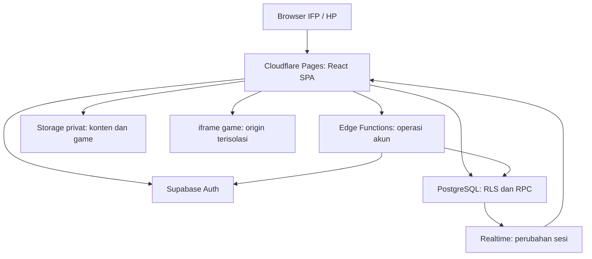

# Arsitektur — LayarBelajar

Versi dokumen 2 — identitas LayarBelajar dan arah soft brutalism.

## Stack dan batas sistem

Stack disetujui: React + TypeScript + Vite, Tailwind CSS, Supabase (PostgreSQL/Auth/Storage/Realtime/Edge Functions), Cloudflare Pages. Ini SPA statis dengan backend terkelola; tidak ada server Node yang harus selalu hidup. Next.js adalah alternatif jika SEO per materi kemudian menjadi prioritas. Versi patch dan Node LTS harus diverifikasi dan dikunci pada M-001; dokumen ini tidak mengklaim versi terbaru tertentu.

Tambahan teknik yang diusulkan sebagai default: React Router untuk rute, TanStack Query untuk data server, Zod untuk kontrak input, Vitest/Testing Library untuk unit/UI, Playwright untuk alur browser. Verifikasi kompatibilitas dan lisensi sebelum pemasangan. Styling print cukup CSS. Editor blok sederhana berbasis schema; jangan membangun editor dokumen serbaguna.

Game tidak menerima JWT atau client Supabase. Video merupakan integrasi tautan eksternal tanpa API key; muat hanya saat pengguna memilih. Auth adalah identitas, sedangkan RLS dan RPC adalah otorisasi. Hanya konten terbit boleh publik; tabel nilai dan kunci jawaban tidak pernah menjadi sumber publik.

## Modul dan arah dependensi

Struktur berikut direncanakan, belum ada dalam paket spesifikasi. `src/app` menyusun router/provider. `src/features` memuat modul di bawah. Tiap modul membagi UI, application, domain dan infrastructure seperlunya, bukan membuat file kosong untuk memenuhi pola. `src/shared/ui` hanya komponen yang dipakai beberapa fitur. `supabase/migrations`, `supabase/functions`, `tests/e2e` dan `scripts` dibuat pada implementasi.

| Modul | Tanggung jawab dan antarmuka | Data yang dimiliki |
|---|---|---|
| catalog | searchPublishedContent, getPublishedRevision | Proyeksi katalog dan taxonomy |
| authoring | saveDraft, publishRevision, archiveContent | Konten, revisi dan bank soal |
| media | validateUpload, attachAsset, downloadAsset | Metadata berkas dan Storage |
| games | validateSingleHtml, createGameFrame, resetGame | Pemutar; hanya referensi aset, tanpa skor |
| identity | login, changePassword, provisionUser, deactivate | Profiles dan akses Auth |
| classes | createClass, manageMemberships | Kelas dan anggota |
| sessions | createSession, join, transition, getState | Sesi dan peserta |
| assessment | saveAnswer, gradeObjective, gradeEssay | Attempts, jawaban dan nilai |
| reports | getOwnHistory, getClassResults | Proyeksi nilai, tidak menulis skor |
| print | renderWorksheet, renderClassReport | Tidak memiliki penyimpanan sendiri |

Arah: UI → application → domain; infrastructure mengimplementasikan akses jaringan/persistensi. Domain tidak mengimpor React atau Supabase. UI tidak membuat query langsung. Tiap modul mengekspor API kecil; hindari barrel global dan state raksasa. Satu file satu tanggung jawab mengikuti [rules](./rules.md).

## Alur runtime

### Login username tanpa email pribadi

Supabase password login menerima email/telepon, bukan username native. Adapter mengubah username yang telah dinormalisasi menjadi alias internal `username@accounts.invalid`. Alias ini identitas teknis, bukan alamat siswa dan tidak pernah dipakai mengirim email. Admin membuat akun melalui Edge Function terautentikasi dan Admin API, dengan alias dikonfirmasi. Pendaftaran publik dan pengiriman email dimatikan. UI tetap hanya meminta username/password. Reset dikelola admin; password tidak ditulis ke profiles/log.

Database profiles menjadi sumber peran/aktif; jangan percaya role pada metadata yang dapat diedit klien. Bootstrap admin pertama melalui skrip lokal berprivilege yang dijalankan pemilik, tanpa endpoint publik. Admin API secret hanya di Edge Function/skrip lokal. RLS harus menolak akses ketika akun nonaktif atau wajib mengganti password. Uji kompatibilitas domain .invalid pada M-002; jika penyedia menolak, jangan menukar model login diam-diam, laporkan penghambat.

### Publikasi materi dan game

Admin menyimpan metadata/draf via RPC, unggah objek privat, lalu publikasi memvalidasi seluruh referensi dalam transaksi. Katalog publik membaca proyeksi revisi aktif. Game diambil sebagai teks melalui Storage berizin, dimasukkan ke `srcdoc` iframe dengan `sandbox="allow-scripts"` saja; tanpa `allow-same-origin`, pop-up, navigasi induk atau form. CSP dalam dokumen game memblokir jaringan; beri izin inline script/style dan gambar data/blob seperlunya. Jangan menjalankan HTML admin di DOM induk. Pratinjau memakai jalur yang sama. Aset game satu HTML harus self-contained; pustaka CDN tidak didukung pada MVP.

Semua bucket privat. Policy Storage mengizinkan baca anonim hanya aset yang direferensikan revisi terbit saat ini. Pembacaan aset riwayat hanya untuk admin atau peserta/pemilik sesi yang relevan. Policy tidak bergantung pada nama berkas sebagai otorisasi. URL unduh bukan jaminan pencabutan terhadap salinan yang sudah diunduh.

### Sesi, jawaban dan nilai

Guru membuat sesi dengan revisi immutable → siswa join dengan kode melalui RPC → RPC memeriksa keanggotaan dan masa berlaku → upsert peserta/attempt → guru membuka soal. Browser berlangganan perubahan baris sesi berizin; event hanya pemicu ambil state terbaru, bukan sumber kebenaran atau saluran kirim kunci.

`submit_answer` mengunci keadaan sesi dan attempt dalam transaksi, memeriksa soal terbuka serta versi jawaban, lalu menyimpan dan menilai objektif server-side. Semua perubahan state sesi mengambil lock sesi yang sama untuk menentukan urutan tutup/kirim. Retry identik memakai idempotency key. Nilai/benar-salah tidak dikirim sebelum selesai. Setelah putus jaringan klien mengambil snapshot state/version baru. Polling 5 detik saat tab terlihat adalah fallback terbatas jika Realtime gagal; tidak membuat listener ganda.

## Keamanan dan pemulihan

RLS deny-by-default untuk tabel/Storage. RPC berprivilege harus fixed search_path, referensi schema eksplisit, validasi auth.uid/peran/keanggotaan dan EXECUTE grants minimum. Kunci soal berada pada schema privat tanpa grants API. Views publik harus security_invoker jika berlaku dan mengecualikan kolom sensitif; pengujian menggunakan anon/siswa/guru lain, bukan hanya service role.

Kelas, nilai, jawaban dan profil tidak masuk cache publik/CDN. Jangan menyimpan respons privat di service worker. Koneksi memakai HTTPS. Input blok disanitasi/dirender secara struktural. Batasi join/login, ukuran HTML, panjang jawaban dan unggah. Logging cukup request ID, kode error, aktor internal dan waktu; jangan log jawaban, password, JWT atau isi berkas.

Cadangan manual mingguan dan sebelum migrasi: dump database yang diperlukan beserta metadata Auth sesuai prosedur resmi, ekspor objek Storage, manifest hash. Simpan terenkripsi di perangkat pemilik, bukan katalog publik/repo. Lakukan drill pemulihan lokal termasuk pengaitan profil dan akun; jika kredensial tidak dapat dipulihkan, reset akun melalui admin dan pertahankan pemetaan UUID. Target operasional asumsi: kehilangan data maksimal satu minggu, pulih dalam satu hari kerja; bukan SLA penyedia. Langkah final CLI diverifikasi saat implementasi.

## Build dan rilis

Lokal: Vite, Supabase CLI + Docker, fixture akun sintetis. Produksi: satu Cloudflare Pages dan satu Supabase Free; development memakai lokal untuk menghemat proyek. Build output `dist`; konfigurasi fallback SPA agar refresh deep-link bekerja. Frontend hanya menerima URL/public key; tidak ada service-role secret dengan prefix VITE_. Migrasi dan fungsi dipasang sebelum frontend yang membutuhkannya. Perubahan kompatibel lebih dulu; jangan reset produksi.

CI: format/lint/typecheck/unit/build; integrasi local Supabase untuk RLS/RPC; E2E alur inti sebelum rilis. Deployment dilakukan setelah akses layanan tersedia dan otorisasi pemilik untuk tindakan produksi. Paket ini hanya spesifikasi, tidak membuat layanan.

Keterbatasan: SPA tidak dioptimalkan untuk indeks pencarian per materi; Supabase Free bisa dijeda setelah tidak aktif; file publik dapat menghabiskan egress walau akun sedikit. Tinjau kuota sebelum mengajar setelah libur, gunakan video tautan, hindari ping buatan untuk menyiasati jeda. Rincian sumber dan pemicu evaluasi ada di [decisions](./decisions.md).

## Implementasi desain v2

Identitas LayarBelajar dan REQ-014 memakai token kanonis pada [design](./design.md). Tambahkan lokasi yang direncanakan `src/styles/tokens.css` untuk CSS custom properties, `src/styles/print.css` untuk cetak, dan `src/shared/ui` untuk Button, Input, Card, Badge, Alert dan Dialog. Tailwind membaca variabel semantik melalui mekanisme versi yang terpasang; jangan menyalin hex ke tiap feature. Modul katalog memilih variant melalui mapper jenis konten. Modul print memiliki override presentasi saja.

Konfigurasi statis `src/app/brand.ts` menyimpan nama aplikasi/wordmark dan tagline opsional. Tidak perlu tabel database tema, layanan font, dependency animasi atau paket ikon berbayar. Mode presentasi memakai atribut/container khusus agar ukuran IFP tidak memengaruhi editor. State selected/loading/error adalah kontrak komponen yang dapat diuji. Tema parent tidak melintasi boundary iframe game; tidak menambah komunikasi token atau akses origin karena perubahan gaya.
